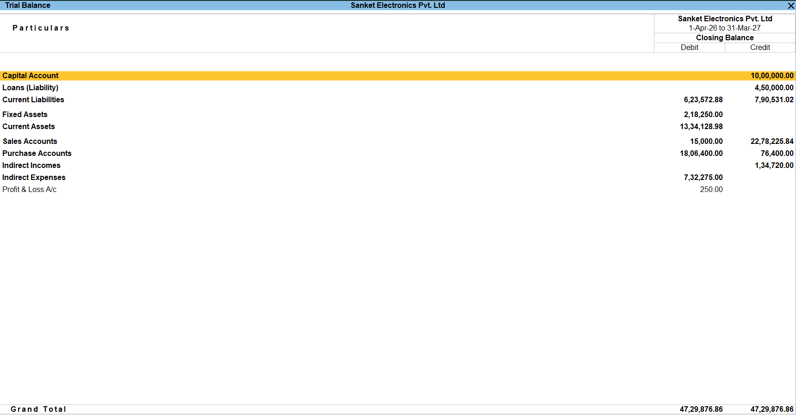
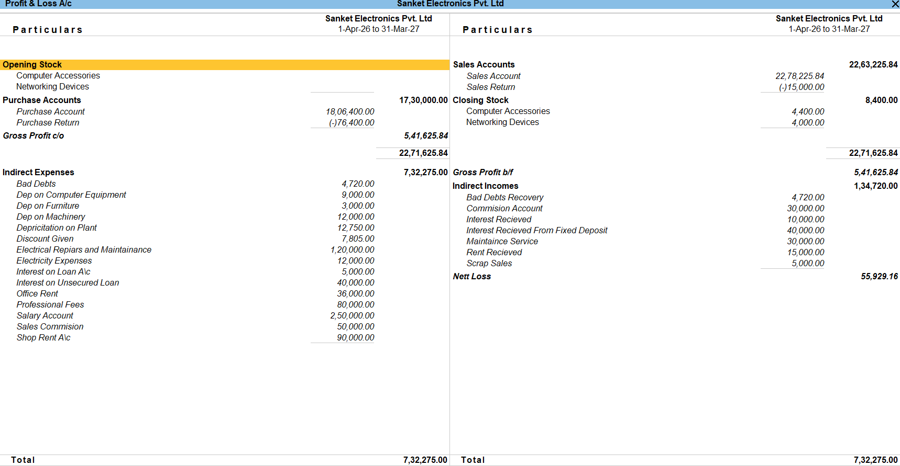
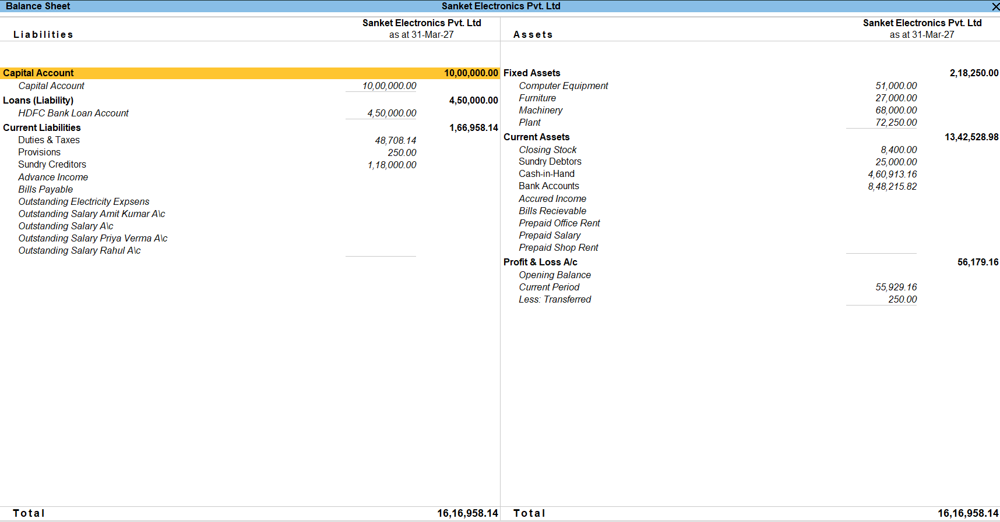
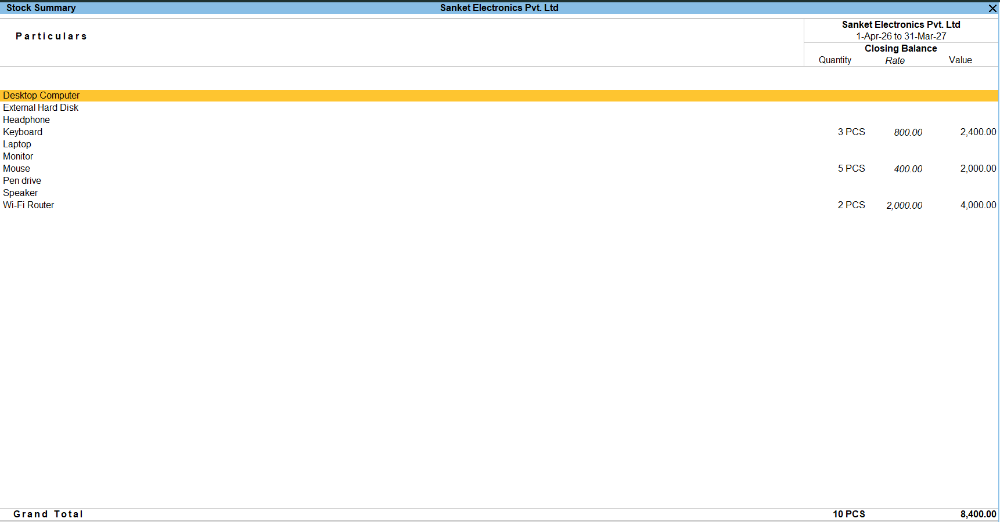
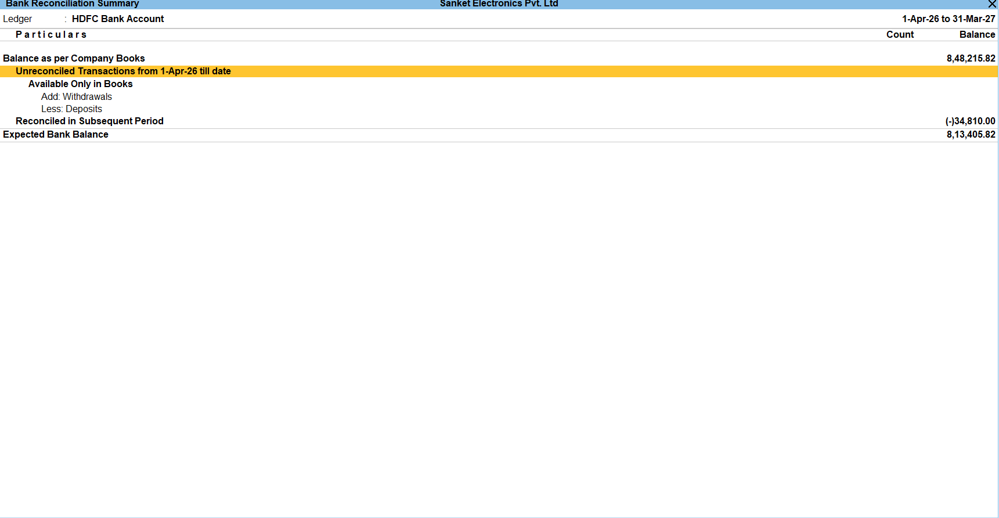

# Sanket Electronics Pvt. Ltd.
## Practical Accounting & Inventory Management Using TallyPrime

## 📌 Overview 

This project demonstrates practical accounting and inventory management operations using **TallyPrime** for a fictional electronics trading company, Sanket Electronics Pvt. Ltd. The project simulates business accounting activities, covering transaction recording, taxation, inventory management, banking operations, adjustment entries and financial reporting. The main objective was to gain hands-on experience with TallyPrime and understand how accounting operations are managed in a business environment.

 ## 🏢 Business Challenge

• Electronics trading businesses handle numerous daily transactions involving purchases, sales, inventory movements, customers, suppliers, taxation and banking activities.

• Managing these operations requires accurate accounting records, proper ledger classification, inventory tracking and reliable financial reporting.

• This project was designed to simulate these business activities and apply accounting concepts through practical exercises in TallyPrime.

## 💡 Solution

• Using TallyPrime, I created and configured a fictional company and performed practical accounting and inventory management operations.

• The project covers the complete accounting workflow, from recording business transactions to reviewing the Trial Balance, Trading Account, Profit & Loss Account and Balance Sheet.

## ⭐ Key Features

### 1. Accounting & Ledger Management

### 2. GST & TDS Accounting

### 3. Inventory Management

### 4. Banking Operations

### 5. Advanced Accounting Concepts

### 6. Financial Reporting

## 🖼️ Project Screenshots

### Trial Balance

### Trading & Profit and Loss Account

### Balance Sheet

### Stock Summary

### Bank Reconciliation Statement

## 🛠️ Tools & Technologies

•  **TallyPrime:** Accounting, taxation and inventory management.

• **Microsoft Excel:** Financial report handling and data presentation.

•  **PDF:** Financial report documentation and sharing.

## 🎯 Project Outcome

This project strengthened my understanding of accounting principles and provided hands-on exposure to:

• Recording and managing business transactions.

•  Maintaining customer and supplier accounts.

•  Applying GST and TDS accounting concepts.

•  Managing inventory across multiple godowns.

•  Performing bank reconciliation exercises.

•  Recording adjustment entries.

•  Preparing and interpreting financial statements.

**Thank you for visiting my project!**
